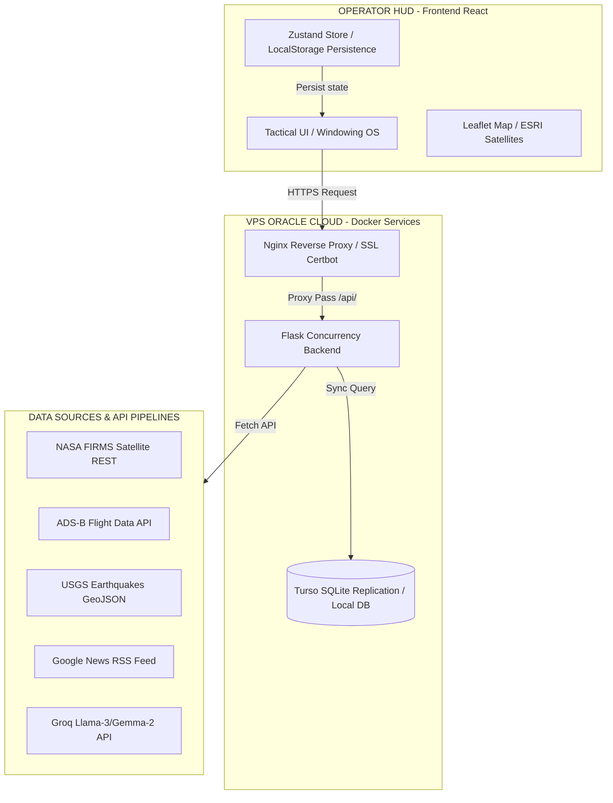

#  RAVEN-X: AI-Powered Multi-Domain Command & Control System
### *Real-Time Geospatial Intelligence, Spatiotemporal Data Engineering & Agentic LLM Diagnostics*

---

##  GIỚI THIỆU CHUNG (PROJECT OVERVIEW)
**RAVEN-X** là một hệ thống Trạm Chỉ huy Tình báo Đa nhiệm (Multi-Domain Command & Control System) mô phỏng theo ngôn ngữ thiết kế của các hệ thống tình báo cao cấp (như Palantir Gotham). Dự án được thiết kế và phát triển bởi sinh viên ngành **Trí tuệ Nhân tạo & Khoa học Dữ liệu**, tập trung vào việc xử lý các bài toán:
*   **Agentic Workflow & LLM Reasoning:** Tự động hóa phân tích tình báo chiến lược sử dụng các mô hình ngôn ngữ lớn (LLM).
*   **Spatiotemporal Data Engineering:** Thu thập, chuẩn hóa và biểu diễn dữ liệu không gian - thời gian thực từ các nguồn dữ liệu vệ tinh, địa chất và hàng không toàn cầu.
*   **High-Concurrency Pipelines:** Xây dựng hệ thống thu thập dữ liệu bất đồng bộ hiệu năng cao chạy ổn định trên cấu hình VPS Cloud tối giản (Free-tier).

---

##  CÁC TRỤ CỘT AI & KHOA HỌC DỮ LIỆU (AI & DATA SCIENCE PILLARS)

### 1. Trợ Lý Phân Tích Chiến Lược (AI Situational Awareness Handler)
Hệ thống tích hợp **AI Handler** chạy trên hạ tầng **Groq API** (SSE streaming) với cơ chế auto-fallback 3 tầng model: **`qwen/qwen3.8-27b` → `openai/gpt-oss-120b` → `openai/gpt-oss-20b`** khi gặp giới hạn quota/rate limit để hỗ trợ tổng hợp Báo cáo Tình hình Chiến dịch (SITREP):
*   **Context-Injection Pipeline:** Tự động gom trạng thái telemetry của hệ thống (thời tiết, thị trường, sự kiện OSINT, dữ liệu bay ADS-B, động đất USGS, cháy rừng NASA FIRMS) vào system prompt kèm thẻ cô lập dữ liệu ngoài `<untrusted_osint_data>` chống prompt injection.
*   **Prompt Engineering:** Tổng hợp tương quan đa nguồn để hỗ trợ đánh giá rủi ro và đưa ra khuyến nghị giám sát.

### 2. Xử Lý Luồng Dữ Liệu Không Gian - Thời Gian (Spatiotemporal Analytics)
*   **Outlier & Noise Filtering (Lọc nhiễu vệ tinh NASA FIRMS):** Dữ liệu nhiệt lượng bề mặt trái đất được lọc theo mức confidence ($\ge 30$) và sắp xếp theo năng lượng bức xạ nhiệt (FRP - Fire Radiative Power) để ưu tiên hiển thị top 300 điểm cháy lớn nhất.
*   **Geofencing & Collision Detection:** Cho phép vẽ các vùng cấm (Geofence) và tính toán khoảng cách không gian (Rangefinder) thời gian thực trên nền bản đồ phân giải cao (Esri World Imagery / Sentinel-2 / NASA GIBS).

### 3. Trích Xuất Tri Thức Từ Nguồn Tin Mở (OSINT & Rule-Based Regex Tagging)
*   **Rule-Based Severity & Country Tagging:** Dữ liệu tin tức từ Google News RSS được gắn nhãn mức độ (`HIGH` / `MEDIUM` / `INFO`) và ánh xạ khu vực bằng bộ quy tắc Regex (`re.search`) ở backend; tin tức dịch bệnh được phân loại mức độ (`PANDEMIC` / `EPIDEMIC` / `OUTBREAK`) và đường lây truyền tương tự.
*   **Interpol Database Integration:** Truy vấn công khai API Interpol Red/Yellow Notices và FBI Wanted để tra cứu đối tượng truy nã theo thời gian thực.

---

##  KIẾN TRÚC HỆ THỐNG (SYSTEM ARCHITECTURE)



*   **Concurrency & Performance Optimization:** Backend Flask triển khai đa luồng (`ThreadPoolExecutor`) giúp thu thập tin tức, dữ liệu thời tiết của hàng trăm quốc gia song song mà không nghẽn luồng chính. Tích hợp cache ngắn hạn để tối ưu chi phí API.
*   **Zero-Downtime Database:** Sử dụng **Turso Cloud (libSQL)** đồng bộ dữ liệu người dùng và cấu hình trạm chỉ huy linh hoạt, hỗ trợ chế độ ngoại tuyến (fallback về tệp SQLite cục bộ `ravenx.db` trên VPS Oracle khi mất mạng).

---

##  HƯỚNG DẪN CHẠY LOCAL & TRIỂN KHAI VPS (DEPLOYMENT PROTOCOL)

### 1. Chạy Thử Ở Local (Local Sandbox)
Chạy trực tiếp trên Windows bằng script tự động hóa:
1. Đảm bảo máy tính đã cài đặt Python 3.10+ và Node.js.
2. Click đúp vào file `start.bat`. Script sẽ tự động:
   * Cài đặt dependencies cho Python Backend (`backend/requirements.txt`).
   * Khởi động Flask server trên port `http://localhost:5000`.
   * Khởi động frontend Vite trên port `http://localhost:5173`.
   * Tự động mở trình duyệt truy cập hệ thống chỉ huy.

### 2. Chạy Docker trên máy sạch (Local Docker Sandbox)
1. Tạo file `backend/.env` từ mẫu:
   ```bash
   cp backend/.env.example backend/.env
   # Điền GROQ_API_KEY của bạn vào backend/.env
   ```
2. Khởi chạy stack local (không cần SSL `/etc/letsencrypt`):
   ```bash
   docker compose -f docker-compose.local.yml up --build -d
   # Truy cập http://localhost:8080
   ```

### 3. Triển Khai Lên VPS Oracle (Production Cloud Docker)
1. Cấu hình biến môi trường production trong `backend/.env` và `tactical-ui/.env.production`:
   ```env
   VITE_BACKEND_URL=https://ravenx-protocol.duckdns.org
   ```
2. Build và khởi động các container bằng Docker Compose trên VPS Oracle:
   ```bash
   docker compose up --build -d
   ```
3. Cấu hình chứng chỉ SSL Let's Encrypt cho tên miền của bạn thông qua volume `/etc/letsencrypt` kết nối trực tiếp với Nginx.

### 4. Chạy Automated Tests (Backend)
```bash
cd backend
pytest -v
```

---

## 🛡️ TÌNH TRẠNG CLEARANCE & KỶ LUẬT AN NINH MẠNG
*   **Phát Triển Độc Lập:** Hệ thống thiết kế khép kín cho 1 Operator duy nhất điều hành thực địa (Single-Operator Mode), tích hợp lưu trữ an toàn trạng thái vận hành trên LocalStorage để ngăn ngừa mất dấu vị trí tác chiến kể cả khi mất kết nối đột ngột hoặc Reload F5.

---
