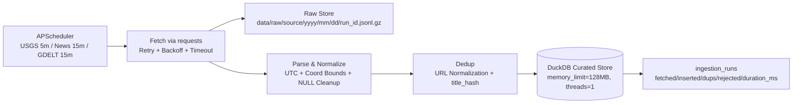

# RavenX Data Ingestion Pipeline (Phase 1)

Isolated background ingestion service collecting **USGS Earthquakes**, **Google News RSS**, and **GDELT** into a two-tier local warehouse (`data/raw/` JSONL.gz + `data/ravenx.duckdb` curated tables) without touching or risking the live Flask/React dashboard.

## Architecture & Data Flow



## Why DuckDB on a 1 GB RAM VPS?
- **Zero daemon overhead:** DuckDB runs embedded inside the pipeline container (no separate PostgreSQL/ClickHouse/Neo4j server consuming 300–500 MB idle RAM).
- **Strict memory bounding:** Configured with `SET memory_limit='128MB'` and `SET threads=1`, keeping the container well under the 150 MB target on a 1 GB Oracle Free Tier VPS.
- **Analytical & Parquet ready:** Supports fast analytical SQL over `events` and `ingestion_runs`, and native `COPY ... TO ... (FORMAT PARQUET)` exports for downstream model training.

## Running Locally
```bash
cd pipeline
pip install -r requirements.txt

# Run all enabled sources once and exit:
python -m ravenx_pipeline.main --once

# Run automated offline tests:
pytest -v
```

## Inspecting `ingestion_runs` and `events`
```bash
python -c "
import duckdb
con = duckdb.connect('pipeline/data/ravenx.duckdb', read_only=True)
print(con.execute('SELECT source, status, fetched, inserted, duplicates, rejected, duration_ms, started_at FROM ingestion_runs ORDER BY started_at DESC LIMIT 10').fetchall())
print('Total curated events:', con.execute('SELECT source, COUNT(*) FROM events GROUP BY source').fetchall())
"
```
